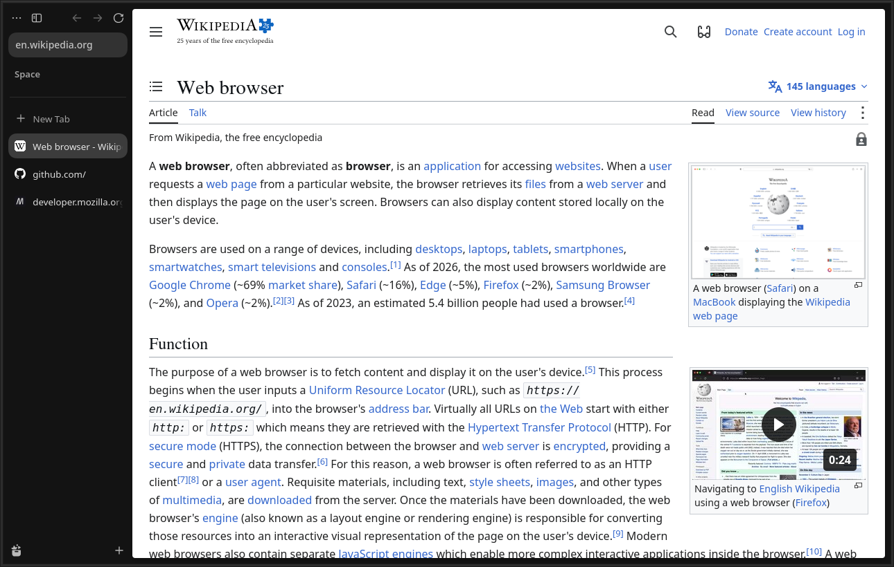
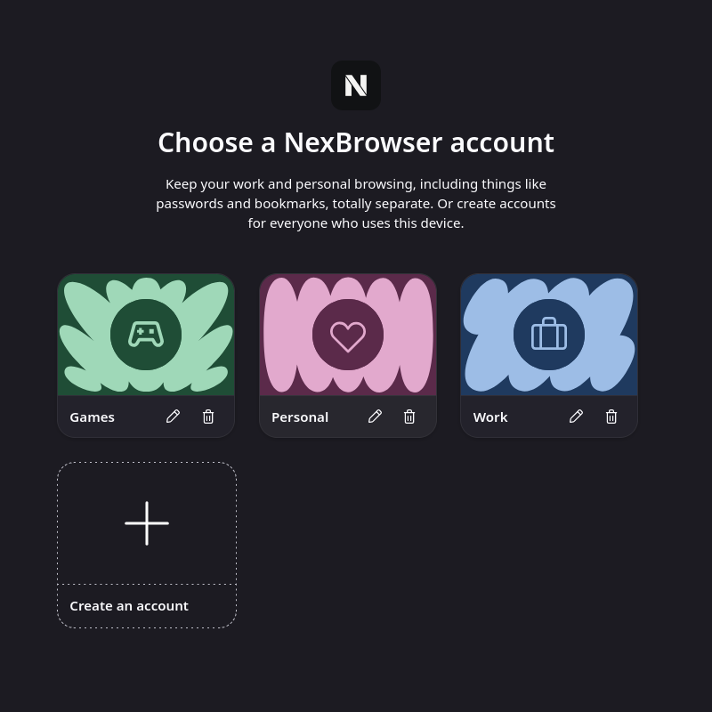
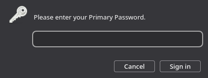

<!--
   - This Source Code Form is subject to the terms of the Mozilla Public
   - License, v. 2.0. If a copy of the MPL was not distributed with this
   - file, You can obtain one at http://mozilla.org/MPL/2.0/.
   -->

<p align="center">
  
</p>

<p align="center">
  <a href="https://github.com/m3lonxd/nexbrowser/releases"></a>
  <a href="https://nexbrowser.vercel.app"></a>
  <a href="./LICENSE"></a>
  <a href="https://github.com/zen-browser/desktop"></a>
</p>

NexBrowser is a desktop browser forked from [Zen Browser](https://github.com/zen-browser/desktop) (itself based on Firefox). It keeps Zen's workspace-driven, distraction-free browsing and adds three things on top: lower idle memory use, a password-locked account system with fully separate encrypted profiles, and a reworked Liquid Glass interface.

## Screenshots

<p align="center">
  
</p>

<p align="center">
  
  
</p>

## Features

- **Liquid Glass interface** — a reworked, translucent UI theme layered on top of Zen's compact mode and workspaces.
- **Lower memory use** — background tabs are unloaded automatically; low-memory defaults ship out of the box.
- **Encrypted, password-locked accounts** — pick an account at launch, each one is a fully separate Firefox profile (`~/.config/nexbrowser`, never touches an existing Zen profile at `~/.config/zen`). The primary account won't open its window until the primary password is entered.
- **Classic downloads button** — the downloads button lives in Zen's original toolbar location instead of Firefox's default spot.
- **New brand, same engine** — own name, icons, and app identity; no connection to Zen's update server, telemetry, or donation prompts. Auto-update is disabled.

## Download

Prebuilt, unsigned binaries for Linux, Windows, and macOS are published on the [Releases page](https://github.com/m3lonxd/nexbrowser/releases).

Because the builds aren't code-signed, the OS will warn you on first launch:

- **Windows (SmartScreen):** click **More info**, then **Run anyway**.
- **macOS (Gatekeeper):** the app is quarantined on first download. Clear the quarantine flag before opening it:
  ```bash
  xattr -cr /Applications/NexBrowser.app
  ```

See [nexbrowser.vercel.app](https://nexbrowser.vercel.app) for an overview of the project.

## Building from source

Build steps follow [Zen's build system](https://docs.zen-browser.app/guides/building) (Firefox/`mach` under the hood). On Linux:

```bash
npm install
npm run init                     # downloads the Firefox source, applies patches, installs dependencies
npx surfer ci --brand release    # selects the NexBrowser brand
npm run build
npm start
```

Brand assets (icons, wordmark) are generated from `branding-src/`:

```bash
node branding-src/generate.mjs               # app icon, .ico/.icns, about:logo
python3 branding-src/wordmark.py <Inter.ttc>  # wordmark logo (requires fontTools)
```

Other useful scripts (see `package.json`): `npm run lint`, `npm test`, `npm run package`.

## Contributing

Report bugs or request features via [GitHub Issues](https://github.com/m3lonxd/nexbrowser/issues). This repository tracks Zen's branch structure (`dev` → `stable`, with `twilight` as the preview branch) — see [`docs/contribute.md`](./docs/contribute.md) and Zen's [Code of Conduct](./CODE_OF_CONDUCT.md) before opening a PR.

## Credit

NexBrowser is a fork of [Zen Browser](https://github.com/zen-browser/desktop), which is itself built on [Mozilla Firefox](https://www.mozilla.org/firefox/). All credit for the underlying engine and the original workspace/compact-mode design goes to the Zen Browser and Mozilla projects. This fork only changes branding, the account/encryption layer, memory defaults, and parts of the UI theme.

## License

[Mozilla Public License 2.0](./LICENSE), same as upstream Zen Browser and Firefox.
